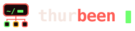

<p align="center">
  
</p>

<h3 align="center">Several coding agents, side by side in one terminal.</h3>

<p align="center">
  <a href="https://thurbox.thurbeen.eu/">Website</a> ·
  <a href="https://discord.gg/fGumcHaxFY">Discord</a> ·
  <a href="https://thurbox.thurbeen.eu/docs/installation.html">Install</a>
</p>

## 📦 thurbox

**[thurbox](https://github.com/Thurbeen/thurbox)** — Coding agents side by side in one terminal: a TUI you reshape in Lua, on Fleet, a declarative Task engine whose sessions outlive the interface, locally or over ssh. Written in Rust.

```bash
# Linux / macOS
curl -fsSL https://raw.githubusercontent.com/Thurbeen/thurbox/main/scripts/install.sh | sh
```

```powershell
# Windows (PowerShell)
irm https://raw.githubusercontent.com/Thurbeen/thurbox/main/scripts/install.ps1 | iex
```

### 🧩 Mods

Every pane is a Lua file you own. These add to it:

- **[thurbox-info-panel](https://github.com/Thurbeen/thurbox-info-panel)** — Session, git, agent, account quota and system readouts beside the terminal.
- **[thurbox-code-review](https://github.com/Thurbeen/thurbox-code-review)** — A Review tab beside Agent and Shell: the session's diff against its base branch, with notes sent to the agent.
- **[thurbox-auto-continue](https://github.com/Thurbeen/thurbox-auto-continue)** — When a Claude Code session hits its usage limit, waits for the reset and types `continue`, once. No LLM involved.
- **[thurbox-fleetlens](https://github.com/Thurbeen/thurbox-fleetlens)** — Fleet Lens: browse Fleet v3 resources, Tasks first, in one keyboard-first float.
- **[thurbox-doom](https://github.com/Thurbeen/thurbox-doom)** — DOOM's engine and WADs behind the Doom tab of thurbox-code-review's agent pane.

## 🛰️ Fleet

**[Fleet](https://github.com/Thurbeen/thurbox/tree/main/docs/fleet)** — The engine under thurbox, shipped with it and installable on its own. You declare Tasks and the other resources; controllers spawn each agent session in its own workspace, send the brief, track pull requests and record the result.

- **[vega](https://github.com/Thurbeen/vega)** — VEGA, a Mission Control for Fleet: one Task whose agent only dispatches work to worker Tasks, follows them and reports back.
- **[herdr-fleetlens](https://github.com/Thurbeen/herdr-fleetlens)** — Fleet Lens for the Herdr app: a keyboard-first float over every Fleet resource kind, with Herdr's live sessions on top and a sidebar that wakes paused sessions.
- **[fleet-reviewer](https://github.com/Thurbeen/fleet-reviewer)** — Fleet plugin that finds open pull and merge requests and starts one review Task per change, amended on every push until it merges or closes.
- **[fleet-factory](https://github.com/Thurbeen/fleet-factory)** — Software factory on Fleet: ticket board to production and back, as infrastructure as code.
- **[agent-observability](https://github.com/Thurbeen/agent-observability)** — Grafana dashboards, Prometheus alerts and an OpenTelemetry quick-start for Fleet, the thurbox interface and the agents they launch.

## 🧠 Agent skills

- **[publish](https://github.com/Thurbeen/publish)** — Gates committed work before it leaves the machine: adversarial review, tests, lint and docs, then push, open the change request and answer every review.
- **[thurview](https://github.com/Thurbeen/thurview)** — Your coding agent reviews an opened pull or merge request on the forge, one summary and one thread per finding, and keeps it current until it merges.

## 🧰 More

- **[gdcruiser](https://github.com/Thurbeen/gdcruiser)** — Static dependency analyzer for Godot: GDScript dependency graphs, cycle detection and architecture rules, ready for CI.
- **[template](https://github.com/Thurbeen/template)** — Starter template for bootstrapping new projects.
